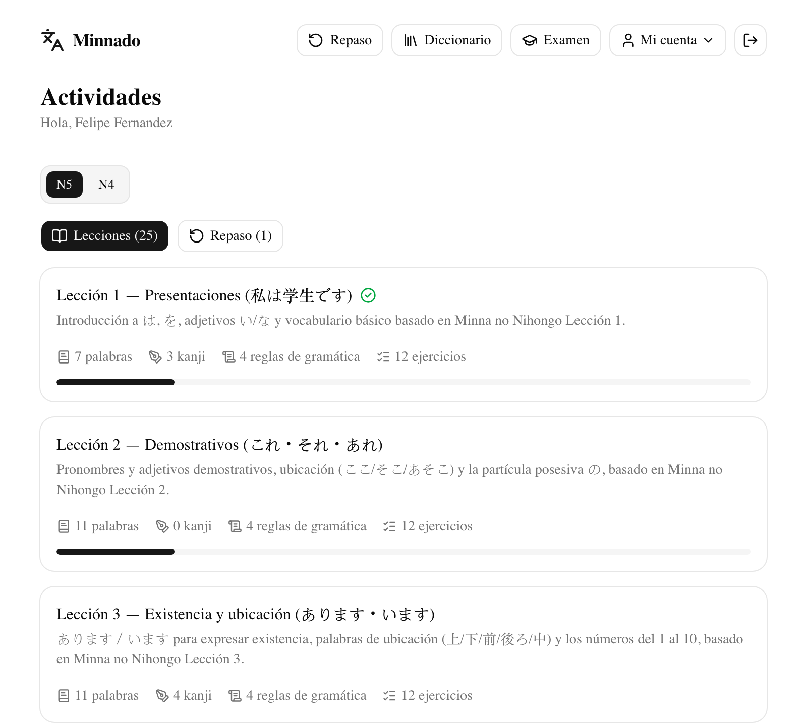
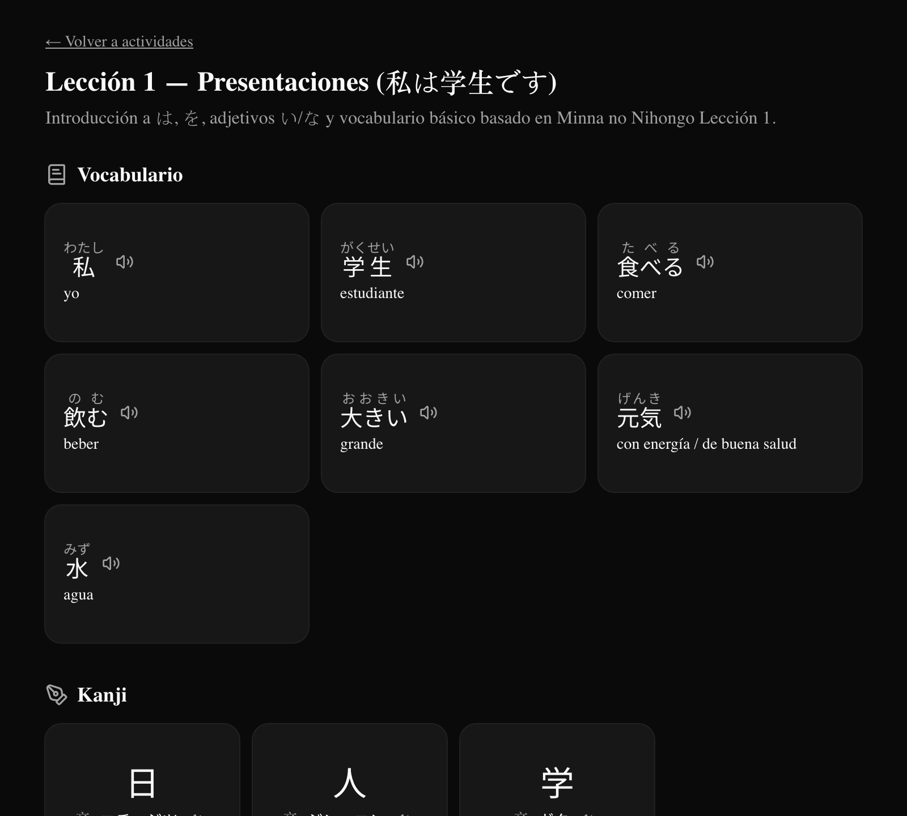
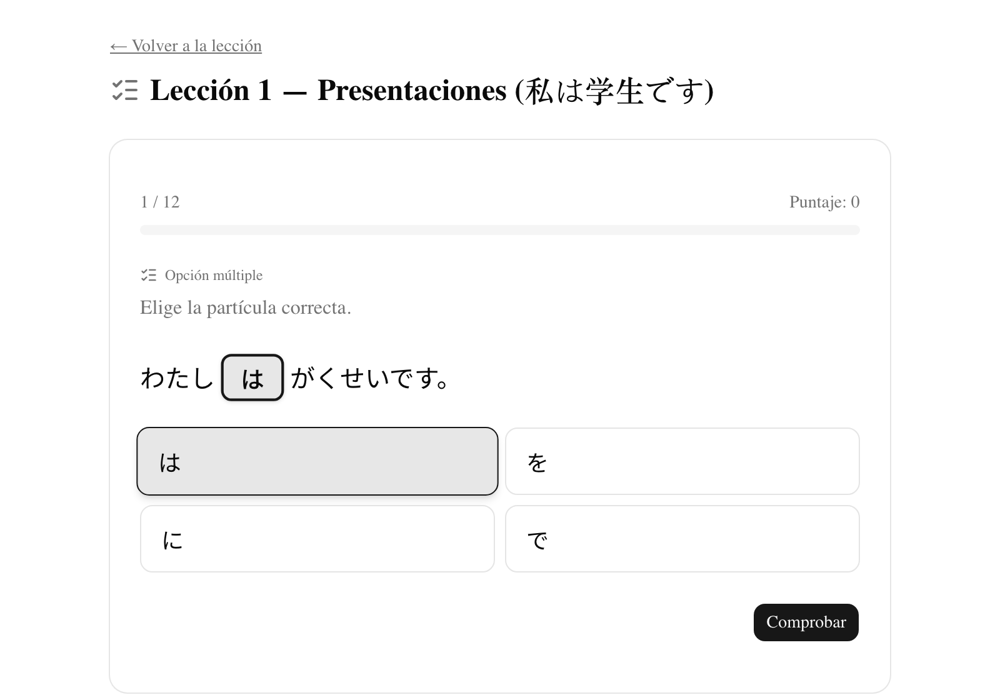
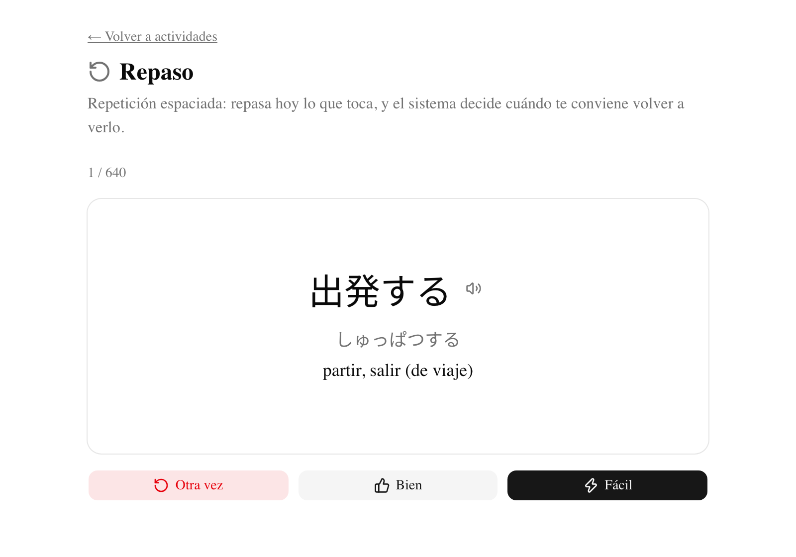
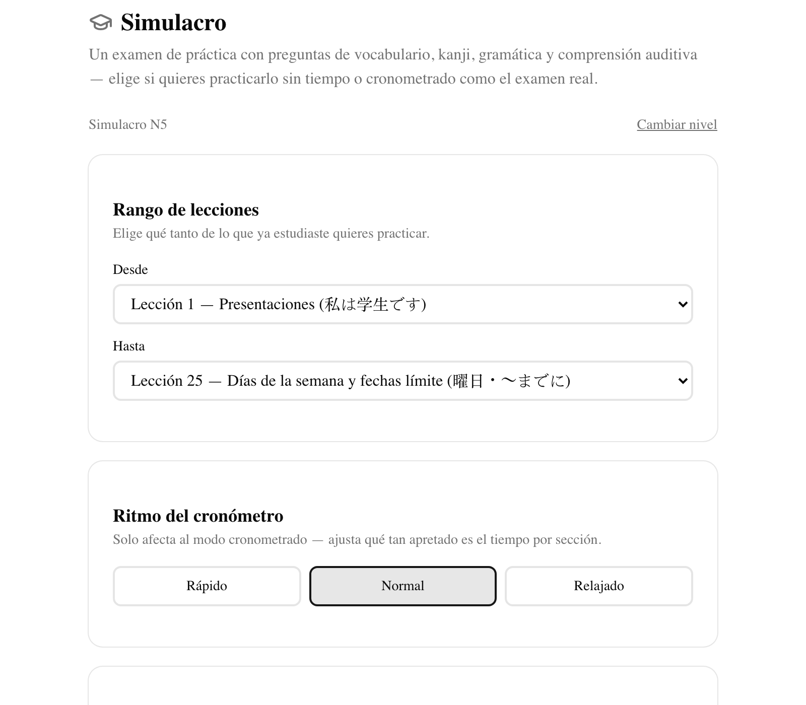
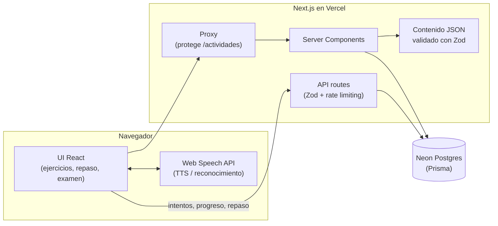

<div align="center">

# Minnado

**Plataforma open source para aprender japonés (JLPT N5 y N4) basada en Minna no Nihongo.**

Lecciones con vocabulario, kanji y gramática · 6 tipos de ejercicios interactivos ·
repaso espaciado (SRS) · simulacro de examen cronometrado

[](https://github.com/pipetboy2001/minnado/actions/workflows/ci.yml)
[](https://github.com/pipetboy2001/minnado/actions/workflows/codeql.yml)
[](LICENSE)


### [🌐 Ver demo en vivo → minnado.vercel.app](https://minnado.vercel.app)


</div>

## Capturas

<table>
  <tr>
    <td width="50%"></td>
    <td width="50%"></td>
  </tr>
  <tr>
    <td align="center"><b>Lecciones</b> por nivel, con progreso por lección</td>
    <td align="center"><b>Lección</b>: vocabulario con furigana, kanji y audio (modo oscuro)</td>
  </tr>
  <tr>
    <td></td>
    <td></td>
  </tr>
  <tr>
    <td align="center"><b>Práctica</b>: ejercicios interactivos con feedback inmediato</td>
    <td align="center"><b>Repaso espaciado</b> (SM-2) de vocabulario y kanji</td>
  </tr>
  <tr>
    <td colspan="2" align="center"><br><b>Simulacro</b> estilo JLPT: rango de lecciones, modo cronometrado y ritmo</td>
  </tr>
</table>

## Funcionalidades

- **51 lecciones** de Minna no Nihongo (lecciones 1–50, N5 y N4), con **445 palabras**, **195 kanji**, **179 reglas de gramática** y **623 ejercicios**.
- **6 tipos de ejercicio**: opción múltiple, completar espacios, ordenar palabras, emparejar, **pronunciación** (reconocimiento de voz) y **comprensión auditiva** (dictado).
- **Repaso espaciado** con una variante de SM-2 (el algoritmo de Anki): el sistema decide cuándo volver a mostrar cada palabra y kanji.
- **Simulacro de examen** estilo JLPT, con secciones de vocabulario/kanji, gramática y comprensión auditiva. Se puede elegir el rango de lecciones y hacerlo cronometrado o sin tiempo.
- **Furigana** sobre los kanji, generado automáticamente a partir del propio contenido.
- **Audio en japonés** para todo el vocabulario, con velocidad configurable.
- **Diccionario** con búsqueda por palabra, lectura, romaji o significado.
- **Progreso** por lección, precisión general e historial de sesiones.
- Cuentas con email y contraseña, recuperación de contraseña por correo, modo claro y oscuro, y diseño responsive.

## Stack

| Área          | Tecnología                                                                                                                                   |
| ------------- | -------------------------------------------------------------------------------------------------------------------------------------------- |
| Framework     | [Next.js 16](https://nextjs.org) (App Router, React 19, React Compiler) + TypeScript                                                         |
| UI            | [Tailwind CSS v4](https://tailwindcss.com) + [shadcn/ui](https://ui.shadcn.com) sobre [Base UI](https://base-ui.com)                         |
| Base de datos | [PostgreSQL serverless en Neon](https://neon.tech) + [Prisma 7](https://www.prisma.io)                                                       |
| Auth          | [Auth.js v5](https://authjs.dev) (credenciales + JWT)                                                                                        |
| Validación    | [Zod](https://zod.dev) para el contenido, las APIs y las variables de entorno                                                                |
| Voz           | [Web Speech API](https://developer.mozilla.org/docs/Web/API/Web_Speech_API) (síntesis y reconocimiento en el navegador, sin costo)           |
| Testing       | [Vitest](https://vitest.dev) + [Testing Library](https://testing-library.com)                                                                |
| Calidad       | ESLint, Prettier, Husky + lint-staged, GitHub Actions (lint, tipos, tests con coverage, build y chequeo de migraciones), CodeQL y Dependabot |
| Deploy        | [Vercel](https://vercel.com)                                                                                                                 |

## Arquitectura



- **El contenido es código**: vive como JSON versionado en `src/content/{n5,n4}` y se valida con Zod. La app lo lee directo de los archivos. La base guarda una copia solo para que el progreso tenga claves foráneas reales.
- **El progreso del usuario** (intentos, sesiones, tarjetas de repaso) se guarda en Postgres.
- **La voz** usa las APIs del navegador, así que no hay costos ni API keys.

Las decisiones técnicas importantes están documentadas como [ADRs](docs/adr) (Architecture Decision Records).

## Empezar

Requisitos: **Node.js 22** y una base de datos en [Neon](https://neon.tech) (el plan gratuito alcanza).

1. Clona el repositorio e instala las dependencias:

   ```bash
   git clone https://github.com/pipetboy2001/minnado.git
   cd minnado
   npm install
   ```

2. Copia `.env.example` a `.env` y completa los valores:

   ```bash
   DATABASE_URL="postgresql://..."   # connection string pooled de Neon
   AUTH_SECRET="..."                 # genera uno con: npx auth secret
   ```

   SMTP es opcional y solo se usa para el correo de recuperación de contraseña.

3. Aplica las migraciones y carga el contenido:

   ```bash
   npm run db:migrate
   npm run db:seed
   ```

4. Levanta el servidor de desarrollo y abre [http://localhost:3000](http://localhost:3000):

   ```bash
   npm run dev
   ```

## Scripts útiles

| Script                  | Descripción                                        |
| ----------------------- | -------------------------------------------------- |
| `npm run dev`           | Servidor de desarrollo                             |
| `npm run build`         | Build de producción                                |
| `npm run lint`          | ESLint                                             |
| `npm run typecheck`     | Verifica tipos de TypeScript                       |
| `npm test`              | Corre la suite de tests (Vitest)                   |
| `npm run test:coverage` | Tests con reporte de coverage                      |
| `npm run format`        | Formatea el proyecto con Prettier                  |
| `npm run db:migrate`    | Aplica migraciones de Prisma (desarrollo)          |
| `npm run db:deploy`     | Aplica migraciones de Prisma (producción)          |
| `npm run db:seed`       | Carga el contenido JSON (`src/content`) a Postgres |
| `npm run db:studio`     | Abre Prisma Studio                                 |

## Contribuir

Este es un proyecto open source. Para agregar vocabulario, kanji, gramática o ejercicios, edita los JSON en `src/content/<nivel>/` siguiendo el esquema de `src/content/schema.ts`. La validación con Zod y los tests de integridad te avisan si falta algo o si una referencia está rota. Antes de abrir el PR, revisa la [checklist de QA de contenido](docs/content-qa-checklist.md).

## Licencia

[MIT](LICENSE)
